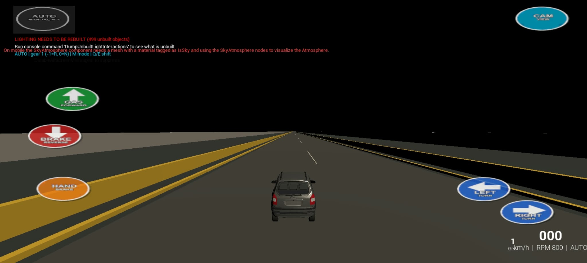
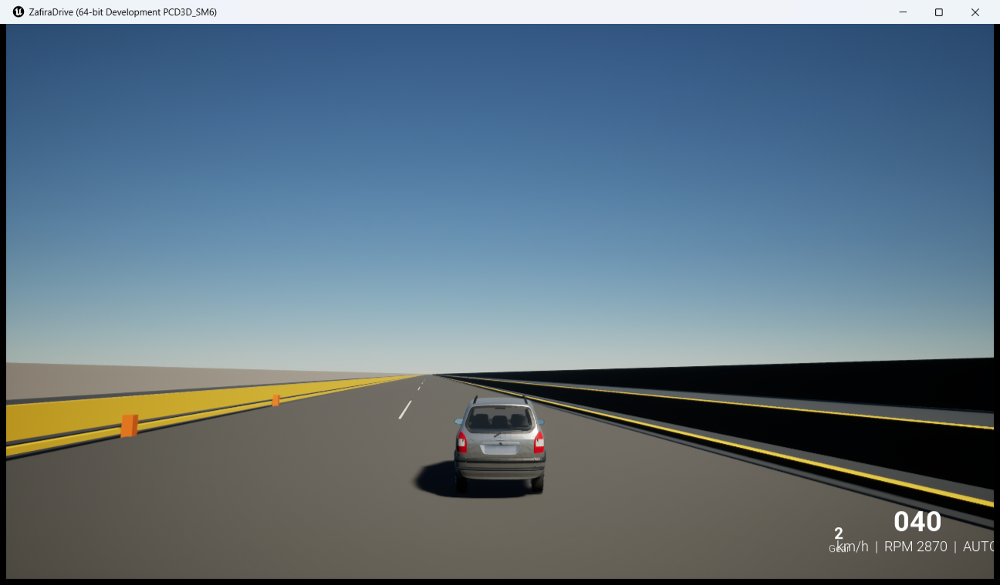
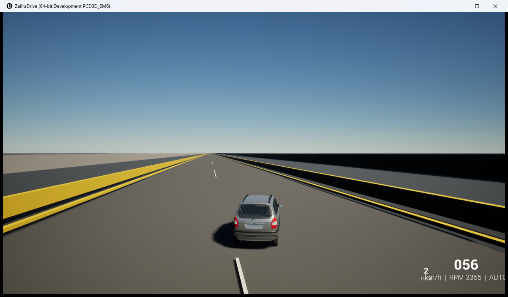

# Opel Zafira 2002 GAME

A mobile Unreal Engine driving prototype based around a 2002 Opel Zafira-style vehicle. The current Android build contains a straight 5 km test road, fixed mobile driving controls, camera swipe/look support, and APK-only packaging so players install one file.

## Download and play

Go to **Releases** and download:

```text
ZafiraDrive-arm64.apk
```

Install that APK on an Android phone. No separate OBB file is required for the latest build because game data is packaged inside the APK.

## Screenshots

### Android mobile controls



### Straight 5 km gameplay road



### Road / boundary view



## Current gameplay state

- Real Unreal Engine project: `ZafiraDrive`
- Android package: `com.YourCompany.ZafiraDrive`
- Default map: `/Game/Zafira/Maps/ZafiraStraight5KM`
- Straight road length target: about 5 km
- Barriers / boundaries included so the vehicle stays on the road
- Kilometer pass markers included
- Mobile controls:
  - left side: gas/forward, brake/reverse, handbrake
  - right side: left/right steering
  - top right: camera view
  - top left: auto/manual indicator; manual is not implemented yet
  - center screen swipe zone for camera look-around
- APK-only output; OBB merged into APK

## Latest local packaged APK

The APK is produced locally at:

```text
BuildOutput/Android_Straight5KM_SingleAPK/ZafiraDrive-arm64.apk
```

That file is intentionally ignored by git and uploaded to GitHub Releases instead.

## Build requirements

This repository is an Unreal Engine project. To rebuild it you need:

- Unreal Engine 5.8
- Android SDK / NDK compatible with UE 5.8
- Java/JBR from Android Studio
- Visual Studio Build Tools on Windows
- Optional: Blender if editing the original source model resources

Known local toolchain used during development:

```text
Unreal Engine: D:/unreal engine/UE_5.8
Android SDK: C:/Users/SAIF/AppData/Local/Android/Sdk
NDK: C:/Users/SAIF/AppData/Local/Android/Sdk/ndk/27.2.12479018
Java: C:/Program Files/Android/Android Studio/jbr
```

## Build command used

From Windows:

```bat
D:\unreal engine\project\ZafiraDrive\Scripts\build_android_single_apk.bat
```

This packages Android with data inside the APK.

## Important files

- `ZafiraDrive.uproject` — Unreal project
- `Config/DefaultEngine.ini` — default map, Android/mobile renderer settings, APK-data-inside setting
- `Config/DefaultInput.ini` — mobile touch interface setting
- `Content/Zafira/Maps/ZafiraStraight5KM.umap` — current playable road map
- `Scripts/build_android_single_apk.bat` — one-APK Android packaging command
- `Scripts/build_android_crashfix.bat` — previous APK+OBB packaging command
- `Scripts/` — Unreal Python setup/fix scripts used to generate maps and mobile controls

## Notes

This is a work-in-progress driving prototype. The current priority was to get the real Unreal project running on Android with the Zafira vehicle, a stable straight road test map, no crash, no separate OBB, and usable mobile controls.
